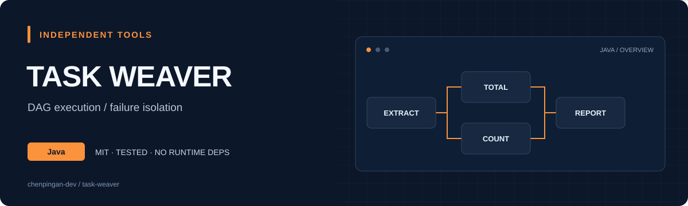
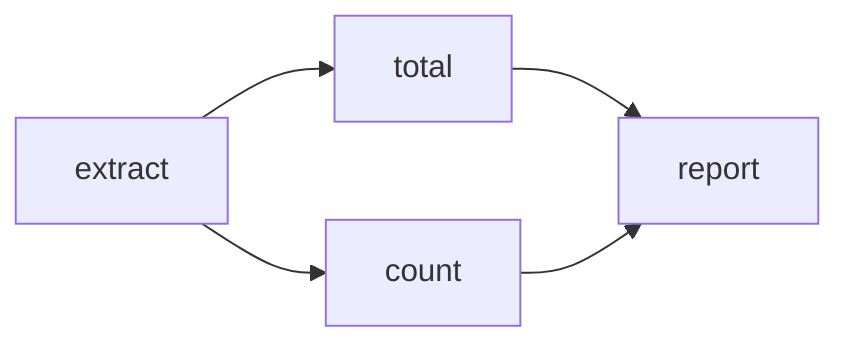

<div align="center">



[](https://github.com/chenpingan-dev/task-weaver/actions/workflows/ci.yml)


**Define dependencies. Run independent work in parallel. Keep failures visible.**

[Run a workflow](#run-a-workflow) · [简体中文](README.zh-CN.md) · [Roadmap](ROADMAP.md)

</div>

Task Weaver is a small, in-process Java task executor. It validates a DAG before running anything, passes dependency results into each action and reports which tasks succeeded, failed or were skipped. No runtime dependencies, network services or company code.

<a id="run-the-example"></a>

## Run a workflow

Requires a JDK 17+ and Python 3.11+ for the portable build helper. Python is only used to invoke Java tools.

```sh
python scripts/build.py --test
java -jar build/task-weaver.jar
java -jar build/task-weaver.jar --zh
```

```text
TASK WEAVER  /  Execution results
extract    SUCCEEDED  [12, 18, 24]
total      SUCCEEDED  54
count      SUCCEEDED  3
report     SUCCEEDED  total=54, count=3
```

The built-in workflow uses synthetic values. `total` and `count` can run concurrently after `extract`; `report` waits for both.

## Use the API

Add `build/task-weaver.jar` to your classpath or copy the MIT-licensed source into your project. This release is not published to Maven Central.

```java
import dev.taskweaver.TaskEngine;
import java.util.List;
import java.util.Set;

try (TaskEngine engine = new TaskEngine(4)) {
    var tasks = List.of(
        new TaskEngine.Task("fetch", Set.of(), inputs -> 21),
        new TaskEngine.Task("transform", Set.of("fetch"),
            inputs -> (int) inputs.get("fetch") * 2)
    );
    var results = engine.execute(tasks).get();
    System.out.println(results.get("transform").value()); // 42
}
```

Actions receive an unmodifiable map containing their direct dependencies' values. Values are `Object`; consumers choose and check their own value types. `null` values are supported. Results preserve the order of the input list rather than completion order.

## Execution model



- The complete graph is checked for duplicate IDs, missing dependencies and cycles before any action is scheduled
- A fixed pool limits simultaneously running actions to 1–64 workers
- Futures schedule actions after dependencies complete; workers never wait for unfinished dependencies
- An action exception produces `FAILED`; dependent actions become `SKIPPED`, while independent branches continue
- `elapsedNanos` measures action execution with `System.nanoTime`, excluding queue time
- A graph supports at most 1,000 tasks; separate executions share the engine's worker pool

Await the execution future before closing the engine. `close()` shuts down the executor; it is not cancellation. Fatal JVM errors can complete the execution future exceptionally. There is no persistence, distributed execution, automatic retry or timeout policy in v0.1.0.

## Verify

`python scripts/build.py --test` runs 17 assertions, including dependency values, graph rejection, failure propagation, parallel execution, worker limits and null values. GitHub Actions checks Windows and Linux with Java 17 and 21, then runs the packaged workflow.

Independent personal project · AI-assisted development · MIT license
